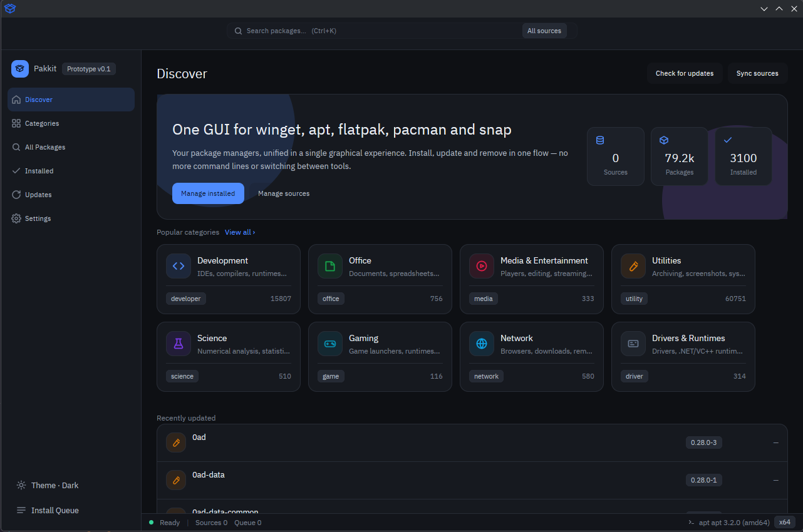

<div align="center"></div>

# Pakkit: One GUI for winget, Chocolatey, Scoop, Homebrew, apt, dnf, flatpak, pacman, zypper, apk and snap

<div align="center">    </div>

<p align="center">
🇺🇸 <a href="./README.md">English</a> | 🇨🇳 <a href="./README.zh.md">简体中文</a>
</p>

**Click to install, commands in the open.**

Mainstream package managers unified into one graphical experience — from winget and Chocolatey to snap, install, update and uninstall in one place, without juggling terminals or hopping between tools. Built with Rust + [gpui-kit](https://crates.io/crates/gpui-kit) 0.8: a real native window, no Electron / WebView.

Every operation is a transparent wrapper around the backend CLI: the command line shown in the UI is exactly the command line that gets executed — nothing hidden, nothing rewritten.



## Table of Contents

- [Features](#features)
- [Installation](#installation)
- [Usage](#usage)
- [Localization](#localization)
- [Project Structure](#project-structure)
- [Contributing](#contributing)
- [License](#license)

## Features

- **Eight views**: Discover, Categories, All Packages, Installed, Updates, Sources, Settings, and Official Install
- **Official Install**: a remote, validated catalog of vendor-provided scripts, installers, and portable downloads. Optional GitHub Releases entries resolve a stable, platform-matched asset on demand. Every command or URL is shown for confirmation; completion distinguishes downloads, opened terminals, and launched installers from verified installation.
- **Queue drawer**: installs / upgrades run serially with configurable concurrency (1–3), showing the command line and progress for each item
- **Package details**: fetched in the background from the backend's own detail command (`winget show`, `choco info`, `scoop info`, `apt show`, `dnf info`, `pacman -Si`, `zypper info`, `apk info`, `snap info`, `brew info`, …) and cached — multi-line description, release notes, tags, publisher, license, homepage, installer type, release date, and more
- **Package icons**: favicons fetched automatically and cached to disk
- **Source management**: add / edit / remove / reset / update sources, with source export
- **Manifest import & export**: built on `winget export` / `winget import` (winget backend)
- **Themes**: dark / light / follow-system, with 5 accent colors
- **Multilingual UI**: five languages with instant switching and persistence; follows the OS language on first launch
- **Friendly error messages**: backend exit codes mapped to readable descriptions (winget's full table, pkexec/polkit denials elsewhere); benign codes treated as success

## Installation

### System requirements

| Platform | Requirements |
| --- | --- |
| Windows | Windows 10 version 1809 or later, or Windows 11; x86_64 or ARM64. Windows 7, 8 and 8.1 are not supported. |
| Linux | A 64-bit desktop with X11 or Wayland. Prebuilt packages are built on Ubuntu 24.04 and require a compatible glibc-based distribution; build from source on other distributions. |
| macOS | macOS 10.15 Catalina or later on Intel or Apple Silicon. macOS currently requires building from source; no prebuilt release is provided. |

Windows 7 cannot run Pakkit: the gpui Windows backend requires newer graphics APIs, and Rust's standard MSVC targets require Windows 10 or later.

### Download a prebuilt release

Grab the latest build from [GitHub Releases](https://github.com/vgerbot-app/pakkit/releases):

| Platform | Arch | Artifacts |
| --- | --- | --- |
| Windows | x86_64 | `.zip` (portable), `.msi` (installer) |
| Windows | arm64 | `.zip` (portable; no MSI — cargo-wix cannot emit arm64 installers yet) |
| Linux | x86_64 / arm64 | `.deb`, `.rpm`, `.AppImage` |

Every release also ships `pakkit-<version>-checksums.txt` — verify any download
with `sha256sum -c`.

Linux packages install the binary to `/usr/bin/pakkit` plus a desktop entry and
icon. On Windows, simply unzip and run `pakkit.exe`, or use the MSI (which can
also add pakkit to `PATH`).

### Build from source

Requirements: Rust 1.92+ (see `rust-toolchain.toml`), Windows, Linux (X11/Wayland) or macOS.

```bash
git clone https://github.com/vgerbot-app/pakkit.git
cd pakkit
cargo build --release
```

> [!NOTE]
> On Windows, running the app requires [winget](https://learn.microsoft.com/windows/package-manager/winget/) (usually built into Windows 10 1809+ / Windows 11), [Chocolatey](https://chocolatey.org/) v2 or [Scoop](https://scoop.sh/). On Linux it drives the native backends it finds: apt, dnf, flatpak, pacman (with yay/AUR), zypper, apk, snap and [Homebrew](https://brew.sh/). On macOS it drives Homebrew.

## Usage

```bash
cargo run --release
```

Or run `target/release/pakkit.exe` directly.

- Search packages in "Discover" / "All Packages"; clicking install enqueues the task into the queue drawer, which executes serially
- Upgrade individual or all packages in the "Updates" view
- Add private sources in "Sources" (requires administrator privileges)
- Switch theme, accent color, and language in "Settings → Appearance"; settings persist to `settings.json`
- Open "Official Install" to search the remote catalog and filter by category, operating system, or architecture. Pakkit downloads `catalog/index.json` and every indexed category document, then validates the complete combined catalog before showing entries. Loading failures offer retry and never fall back to stale, partial, or built-in entries.

### Dynamic GitHub Releases

An `official_page` method can add an optional `release` configuration. A `github_release` source declares `repository` and `packages`; each package declares a supported `format`, architecture-specific `assets` patterns matched against the complete filename (`*` is the only wildcard), and, for Windows, `expectedSigner`. Entries without `release` retain the official-page behavior, older clients ignore the field, and unsupported future providers retain the official-page fallback. Existing catalogs therefore remain compatible.

- **On-demand resolution**: clicking install calls GitHub's documented `releases/latest` API; catalog loading does not resolve releases. Only a non-draft, non-prerelease stable release is accepted.
- **Strict selection**: the host OS, x86_64/ARM64 architecture, and Linux package manager select the package format and exactly one uploaded asset. DEB requires apt; RPM requires dnf or zypper. Zero or multiple filename matches, an asset URL outside the selected repository and tag, or a missing/invalid SHA-256 digest stops dynamic installation.
- **Confirmed snapshot**: confirmation fixes an immutable snapshot of the version, filename, URL, size, SHA-256, and install action. The confirmed download and execution path consumes exactly that snapshot, with no second release lookup or asset selection.
- **Integrity and transport**: the downloaded byte size and SHA-256 must both match before an installer, package manager, or file opener runs. API and asset URLs, including every redirect target, are validated as HTTPS. HTTP is allowed only for explicitly enabled loopback development/test servers; remote HTTP is rejected.

| Resolved format | Behavior after verification |
| --- | --- |
| DEB / RPM | Install through the existing apt/dnf/zypper backends, including their PackageKit/polkit and waitable pkexec authorization paths. |
| Windows EXE | Require valid Authenticode, the exact `expectedSigner` subject, and matching PE architecture, then launch through the Windows shell. Pakkit reports only that the installer started; Windows handles any requested UAC elevation. |
| Windows MSI | Require the same Authenticode/signer checks and a matching MSI architecture, then wait for `msiexec /i`. Pakkit distinguishes completion, reboot required, cancellation, and failure. |
| macOS PKG / DMG | Open the verified file with macOS `open` only; Pakkit does not wait for or confirm installation. |
| Linux AppImage | Mark the verified download executable and report a portable download; never launch it automatically. |

Release providers use the provider-neutral `ReleaseResolver` extension point and produce the same restricted snapshot for confirmation, queueing, download, and platform handlers. Dynamic releases add no generic HTML scraping or arbitrary command execution; release metadata and notes never become shell commands.

**Current limitations:**

- GitHub is currently the only implemented release provider.
- The SHA-256 digest and asset metadata come from the same official GitHub source; the digest is not an independent signature or second-source checksum. Windows Authenticode is a separate platform signature check.
- Real-platform end-to-end validation is still needed on Windows, macOS, and supported Linux systems. Unit tests do not replace validation of platform signatures, elevation, and installer behavior.

## Localization

| Language | Code | Status |
| --- | --- | --- |
| 简体中文 (Simplified Chinese) | `zh-CN` | ✅ |
| 繁體中文 (Traditional Chinese) | `zh-TW` | ✅ |
| English | `en` | ✅ |
| 日本語 (Japanese) | `ja` | ✅ |
| 한국어 (Korean) | `ko` | ✅ |

Strings are embedded at compile time (rust-i18n) and maintained in `locales/*.yml`.

## Project Structure

| Module | Responsibility |
| --- | --- |
| `src/backends/` | One module per package manager (winget, chocolatey, scoop, brew, apt, dnf, flatpak, pacman, zypper, apk, snap): pure-function command builders, output parsers, exit-code mapping (no UI dependencies, independently testable) |
| `src/model.rs` / `src/state.rs` | Data model and application state |
| `src/queue.rs` | Install / upgrade task queue |
| `src/shell.rs` | Main window view `AppView`, the single entry point for state mutation |
| `src/views.rs` / `src/widgets.rs` / `src/dialogs.rs` | Views, widgets, and dialogs (read-only state rendering) |
| `src/icons.rs` / `src/cache.rs` | Favicon fetching and disk caching |
| `src/theme.rs` / `themes/` | Themes and accent colors |
| `locales/` | Strings for the five languages |

See [docs/architecture.md](./docs/architecture.md) for more detail.

## Contributing

Issues and pull requests are welcome. Before submitting, please run:

```bash
cargo fmt
cargo clippy
cargo test
```

## License

[MIT](./LICENSE) © 2026 y1j2x34
