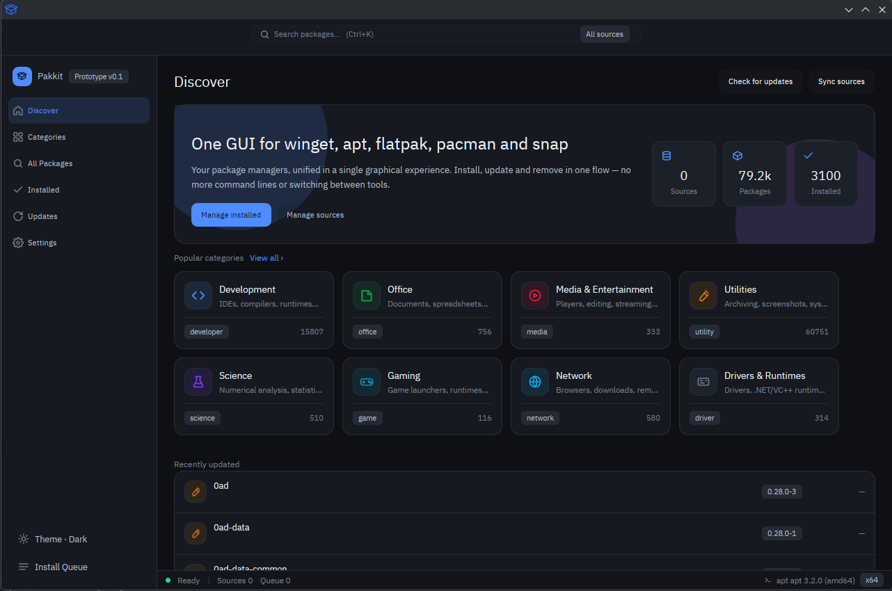

<div align="center"></div>

# Pakkit: One GUI for winget, apt, flatpak, pacman and snap

<div align="center">    </div>

<p align="center">
🇺🇸 <a href="./README.md">English</a> | 🇨🇳 <a href="./README.zh.md">简体中文</a>
</p>

**点一下就装好，命令看得见。**

将多个主流包管理器整合为统一的图形化操作体验。从 Winget 到 Snap，安装、更新、卸载一气呵成——告别命令行与多工具切换。使用 Rust + [gpui-kit](https://crates.io/crates/gpui-kit) 0.8 构建 —— 原生窗口，无 Electron / WebView。

所有操作都是对后端命令行的一层透明封装：界面上显示的命令行就是实际执行的命令行，不隐藏、不改写。



## 目录

- [特性](#特性)
- [安装](#安装)
- [使用](#使用)
- [多语言](#多语言)
- [项目结构](#项目结构)
- [贡献](#贡献)
- [许可证](#许可证)

## 特性

- **七个视图**：发现、分类、全部包、已安装、更新、源管理、设置
- **队列抽屉**：安装 / 升级串行执行，并发可调（1–3），逐项显示命令行与进度
- **软件包详情**：后台调用后端自身的详情命令（`winget show`、`apt show`、`pacman -Si`、`snap info`……）抓取并缓存，展示多行描述、发布说明、标签、发布者、许可、主页、安装类型、发布日期等
- **软件包图标**：自动抓取 favicon 并持久化缓存到磁盘
- **源管理**：添加 / 编辑 / 删除 / 重置 / 更新源，支持源导出
- **清单导入导出**：基于 `winget export` / `winget import`（winget 后端）
- **主题**：深色 / 浅色 / 跟随系统三档，5 个强调色
- **多语言界面**：五种语言即时切换并持久化，首次启动按操作系统语言自动选择
- **友好的错误信息**：后端退出码映射为可读说明（winget 为完整退出码表，其余后端覆盖 pkexec/polkit 拒绝等情形），良性退出码按成功处理

## 安装

### 下载预构建版本

从 [GitHub Releases](https://github.com/vgerbot-app/winget-gui/releases) 下载最新的 Windows 构建。

### 从源码构建

要求：Rust 1.92+（见 `rust-toolchain.toml`），Windows 平台。

```bash
git clone https://github.com/vgerbot-app/winget-gui.git
cd winget-gui
cargo build --release
```

> [!NOTE]
> 运行需要系统已安装 [winget](https://learn.microsoft.com/windows/package-manager/winget/)（Windows 10 1809+ / Windows 11 通常已内置）。

## 使用

```bash
cargo run --release
```

或直接运行 `target/release/pakkit.exe`。

- 在「发现」/「全部包」中搜索软件包，点击安装后任务进入队列抽屉串行执行
- 在「更新」视图中升级单个或全部软件包
- 在「源管理」中添加私有源（需要管理员权限）
- 在「设置 → 外观」中切换主题、强调色与语言，设置持久化到 `settings.json`

## 多语言

| 语言 | 代码 | 状态 |
| --- | --- | --- |
| 简体中文 | `zh-CN` | ✅ 基础语言 |
| 繁體中文 | `zh-TW` | ✅ |
| English | `en` | ✅ 回退语言 |
| 日本語 | `ja` | ✅ |
| 한국어 | `ko` | ✅ |

词条在编译期内置（rust-i18n），于 `locales/*.yml` 中维护。

## 项目结构

| 模块 | 职责 |
| --- | --- |
| `src/winget/` | 纯函数 winget 命令构造器、输出解析器、退出码映射（无 UI 依赖，可独立测试） |
| `src/model.rs` / `src/state.rs` | 数据模型与应用状态 |
| `src/queue.rs` | 安装 / 升级任务队列 |
| `src/shell.rs` | 主窗口视图 `AppView`，状态唯一变更入口 |
| `src/views.rs` / `src/widgets.rs` / `src/dialogs.rs` | 视图、组件与对话框（只读状态渲染） |
| `src/icons.rs` / `src/cache.rs` | favicon 抓取与磁盘缓存 |
| `src/theme.rs` / `themes/` | 主题与强调色 |
| `locales/` | 五种语言词条 |

更多细节见 [docs/architecture.md](./docs/architecture.md)。

## 贡献

欢迎 Issue 与 Pull Request。提交前请运行：

```bash
cargo fmt
cargo clippy
cargo test
```

## 许可证

[MIT](./LICENSE) © 2026 y1j2x34
